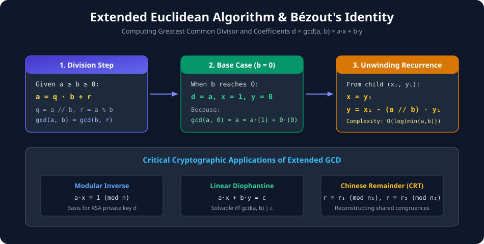
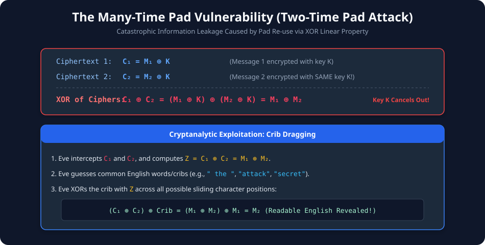
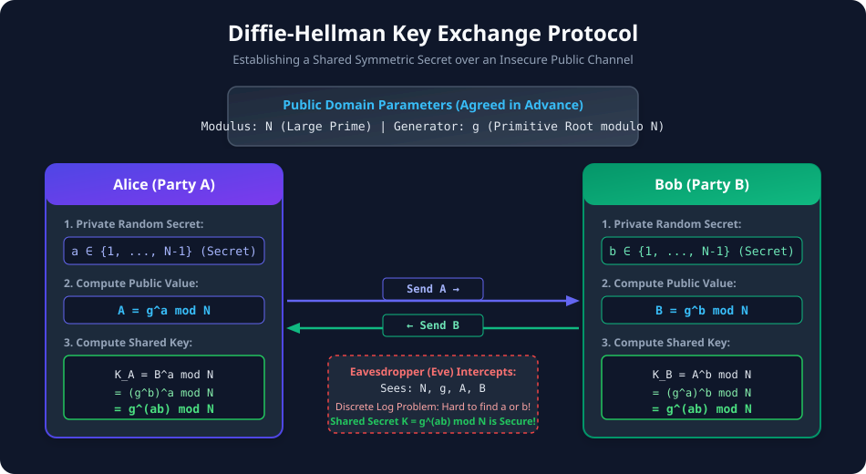
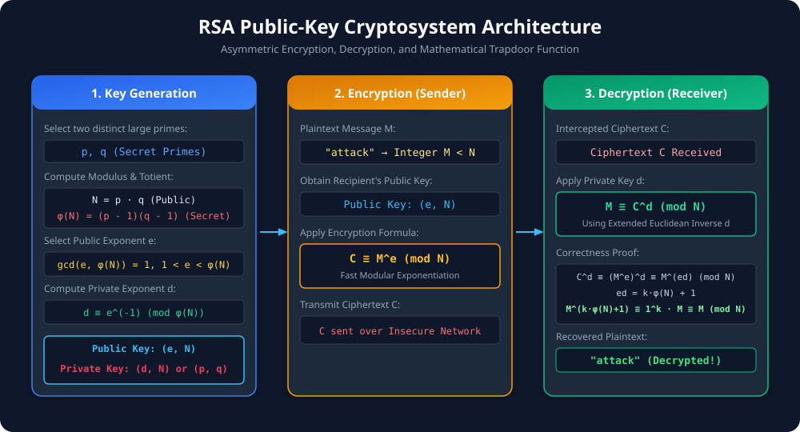
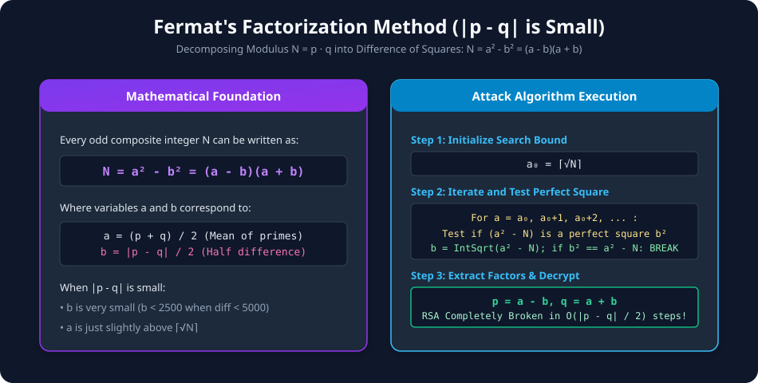
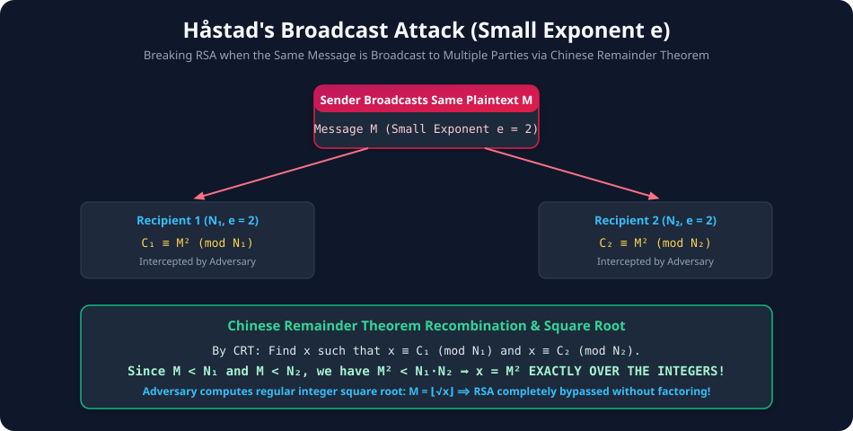
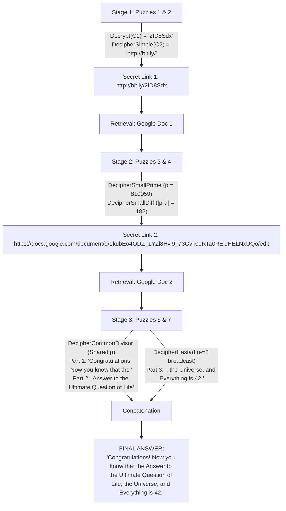

# Class Test 1 (CT-1): Practicing Number Theory & Applied Cryptography

**Student Name:** Mahfuzur Rahman  
**Student ID:** IT23005  
**Course:** Cryptography and Cyber Law 
**Academic:** 4th Year 1st Semester  
**Reference Workshop:** [Introduction to Number Theory and Cryptography Workshop — Maths and Physics Club, IIT Bombay](https://github.com/mnp-club/Number_Theory_and_Cryptography_Workshop)

---

## Interactive Google Colab Practice Notebooks

| Notebook Name | Description | Colab Launch Badge |
| :--- | :--- | :--- |
| **Master Notebook (All-in-One)** | Complete consolidated theory, interactive code, exercises, and quest solutions | [](https://colab.research.google.com/github/IT23005/Cryptography-and-Cyber-Law/blob/main/CT-1%20Practicing%20Number%20Theory/Number_Theory_and_Cryptography_Master.ipynb) |
| **01 Number Theory Foundations** | Extended Euclid, LCM, Diophantine equations, Modular Inverses, Fast Exp, CRT, Repunits, Perfect Numbers | [](https://colab.research.google.com/github/IT23005/Cryptography-and-Cyber-Law/blob/main/CT-1%20Practicing%20Number%20Theory/01_Number_Theory_Foundations.ipynb) |
| **02 Classical & Modern Cryptosystems** | OTP, Many-Time Pad crib dragging, Diffie-Hellman Key Exchange, RSA implementation, Shor's Factoring | [](https://colab.research.google.com/github/IT23005/Cryptography-and-Cyber-Law/blob/main/CT-1%20Practicing%20Number%20Theory/02_Classical_and_Modern_Cryptography.ipynb) |
| **03 RSA Attacks & Cryptanalysis** | The 7 RSA Assignment Scenarios: Small Prime, Fermat Factorization, Shared Factor, Håstad Broadcast, Dictionary | [](https://colab.research.google.com/github/IT23005/Cryptography-and-Cyber-Law/blob/main/CT-1%20Practicing%20Number%20Theory/03_RSA_Attacks_and_Cryptanalysis.ipynb) |
| **04 RSA Cryptographic Quest Solved** | Full step-by-step resolution of the multi-stage treasure hunt, Google Docs parameter retrieval, and final key | [](https://colab.research.google.com/github/IT23005/Cryptography-and-Cyber-Law/blob/main/CT-1%20Practicing%20Number%20Theory/04_RSA_Cryptographic_Quest_Solved.ipynb) |

---

## Table of Contents
1. [Executive Summary & Repository Structure](#1-executive-summary--repository-structure)
2. [Theoretical & Algorithmic Foundations of Number Theory](#2-theoretical--algorithmic-foundations-of-number-theory)
   - [2.1 Greatest Common Divisor & Extended Euclidean Algorithm](#21-greatest-common-divisor--extended-euclidean-algorithm)
   - [2.2 Least Common Multiple (LCM)](#22-least-common-multiple-lcm)
   - [2.3 Linear Diophantine Equations](#23-linear-diophantine-equations)
   - [2.4 Modular Arithmetic, Inverses & Modular Division](#24-modular-arithmetic-inverses--modular-division)
   - [2.5 Fast Modular Exponentiation (Square-and-Multiply)](#25-fast-modular-exponentiation-square-and-multiply)
   - [2.6 Chinese Remainder Theorem (CRT)](#26-chinese-remainder-theorem-crt)
   - [2.7 Advanced Number Theoretic Structures (Repunits, Perfect Numbers, Fermat Pseudoprimes)](#27-advanced-number-theoretic-structures)
3. [Applied Cryptographic Systems](#3-applied-cryptographic-systems)
   - [3.1 Shannon's Perfect Secrecy & One-Time Pad (OTP)](#31-shannons-perfect-secrecy--one-time-pad-otp)
   - [3.2 The Many-Time Pad Vulnerability & Crib Dragging Attack](#32-the-many-time-pad-vulnerability--crib-dragging-attack)
   - [3.3 Diffie-Hellman Key Exchange Protocol](#33-diffie-hellman-key-exchange-protocol)
   - [3.4 The RSA Public-Key Cryptosystem](#34-the-rsa-public-key-cryptosystem)
   - [3.5 Quantum Factoring: Shor's Algorithm Simulation](#35-quantum-factoring-shors-algorithm-simulation)
4. [Practical RSA Cryptanalysis (The 7 Assignment Problems)](#4-practical-rsa-cryptanalysis-the-7-assignment-problems)
   - [Question 1: RSA Encryption Implementation](#question-1-rsa-encryption-implementation)
   - [Question 2: RSA Decryption Implementation](#question-2-rsa-decryption-implementation)
   - [Question 3: Dictionary / Known-Plaintext Attack (DecipherSimple)](#question-3-dictionary--known-plaintext-attack-deciphersimple)
   - [Question 4: Small Prime Factorization Attack (DecipherSmallPrime)](#question-4-small-prime-factorization-attack-deciphersmallprime)
   - [Question 5: Fermat's Factorization Attack for Close Primes (DecipherSmallDiff)](#question-5-fermats-factorization-attack-for-close-primes-deciphersmalldiff)
   - [Question 6: Shared Prime Factor / Common Modulus Attack (DecipherCommonDivisor)](#question-6-shared-prime-factor--common-modulus-attack-deciphercommondivisor)
   - [Question 7: Håstad's Broadcast Attack via CRT (DecipherHastad)](#question-7-håstads-broadcast-attack-via-crt-decipherhastad)
5. [The RSA Cryptographic Quest — Full Resolution](#5-the-rsa-cryptographic-quest--full-resolution)
6. [Automated Verification & Unit Testing](#6-automated-verification--unit-testing)
7. [Installation & Execution Guide](#7-installation--execution-guide)
8. [References & Acknowledgments](#8-references--acknowledgments)

---

## 1. Executive Summary & Repository Structure

This repository documents the complete study, algorithmic development, numerical verification, and practical cryptanalysis for **Class Test 1 (CT-1)** in **Cryptography and Cyber Law**. The work is based on the comprehensive workshop organized by the **Maths and Physics Club, IIT Bombay**.

### Project File Layout
```text
CT-1 Practicing Number Theory/
│
├── README.md                                   # Comprehensive documentation, equations, and analysis
├── number_theory.py                            # Standalone module: Extended GCD, LCM, Diophantine, CRT, Exponentiation
├── cryptosystems.py                            # Standalone module: OTP, Many-Time Pad, Diffie-Hellman, RSA, Shor's
├── rsa_attacks.py                              # Standalone module: 5 practical RSA cryptanalytic attack algorithms
├── run_all_tests.py                            # Automated unit test suite verifying all modules
│
├── 01_Number_Theory_Foundations.ipynb          # Jupyter/Colab notebook for Day 1 & Day 2 algorithms
├── 02_Classical_and_Modern_Cryptography.ipynb  # Jupyter/Colab notebook for OTP, Diffie-Hellman, RSA, Shor's
├── 03_RSA_Attacks_and_Cryptanalysis.ipynb      # Jupyter/Colab notebook for the 7 RSA assignment scenarios
├── 04_RSA_Cryptographic_Quest_Solved.ipynb     # Jupyter/Colab notebook with the end-to-end Quest solution
├── Number_Theory_and_Cryptography_Master.ipynb # Master consolidated notebook ready for Google Colab
│
└── figures/                                    # High-resolution architectural and mathematical vector diagrams
    ├── diffie_hellman_protocol.svg             # Protocol sequence, key exchange, and discrete log barrier
    ├── rsa_cryptosystem_workflow.svg           # Key generation, asymmetric encryption, and decryption flow
    ├── many_time_pad_leakage.svg               # Key cancellation and crib-dragging exploitation
    ├── extended_euclidean_flow.svg             # Division steps, recurrence unwinding, and applications
    ├── fermat_factorization_geometry.svg       # Difference of squares factorization for close primes
    └── hastad_broadcast_attack.svg             # Multi-recipient message broadcast and CRT root extraction
```

---

## 2. Theoretical & Algorithmic Foundations of Number Theory

### 2.1 Greatest Common Divisor & Extended Euclidean Algorithm

#### Mathematical Formulation
The Greatest Common Divisor $\gcd(a, b)$ of two non-negative integers $a$ and $b$ (not both zero) is the largest positive integer that divides both $a$ and $b$.

According to **Bézout's Identity**, for any non-zero integers $a$ and $b$, there exist integers $x, y \in \mathbb{Z}$ such that:
$$d = \gcd(a, b) = a \cdot x + b \cdot y$$

The classical Euclidean algorithm applies the division algorithm repeatedly:
$$a = q_1 \cdot b + r_1, \quad 0 \leq r_1 < b$$
$$\gcd(a, b) = \gcd(b, r_1)$$

The **Extended Euclidean Algorithm (EEA)** calculates $\gcd(a, b)$ and back-substitutes the quotients to determine the Bézout coefficients $(x, y)$. When unwinding the recursion from child state $(d, x_1, y_1)$ where $b \cdot x_1 + (a \bmod b) \cdot y_1 = d$:
$$a \bmod b = a - \left\lfloor \frac{a}{b} \right\rfloor \cdot b$$
$$b \cdot x_1 + \left(a - \left\lfloor \frac{a}{b} \right\rfloor \cdot b\right) y_1 = a \cdot y_1 + b \cdot \left(x_1 - \left\lfloor \frac{a}{b} \right\rfloor y_1\right) = d$$

Thus, the parent coefficients are:
$$x = y_1, \quad y = x_1 - \left\lfloor \frac{a}{b} \right\rfloor \cdot y_1$$



#### Python Implementation
```python
def extended_gcd(a: int, b: int) -> tuple[int, int, int]:
    """Computes gcd(a, b) and Bezout coefficients (x, y) such that d = a*x + b*y."""
    assert a >= b and b >= 0 and a + b > 0, "Requires a >= b >= 0 and a + b > 0"
    if b == 0:
        return (a, 1, 0)
    
    d, x1, y1 = extended_gcd(b, a % b)
    x = y1
    y = x1 - (a // b) * y1
    
    assert a % d == 0 and b % d == 0
    assert d == a * x + b * y
    return (d, x, y)
```
- **Time Complexity:** $O(\log(\min(a, b)))$ by Lamé's Theorem (the number of steps never exceeds 5 times the number of base-10 digits of the smaller number).
- **Space Complexity:** $O(\log(\min(a, b)))$ recursive call stack depth.

---

### 2.2 Least Common Multiple (LCM)

#### Mathematical Formulation
The Least Common Multiple $\operatorname{lcm}(a, b)$ of two positive integers is the smallest positive integer divisible by both $a$ and $b$. By the fundamental theorem of arithmetic:
$$\gcd(a, b) \cdot \operatorname{lcm}(a, b) = a \cdot b \implies \operatorname{lcm}(a, b) = \frac{a \cdot b}{\gcd(a, b)}$$

#### Python Implementation
```python
def lcm(a: int, b: int) -> int:
    """Computes LCM using gcd identity, avoiding integer overflow via order of operations."""
    assert a > 0 and b > 0, "Inputs must be positive integers"
    g = extended_gcd(max(a, b), min(a, b))[0]
    return (a * b) // g
```

---

### 2.3 Linear Diophantine Equations

#### Mathematical Formulation
A linear Diophantine equation in two variables has the form:
$$a \cdot x + b \cdot y = c \quad (a, b, c \in \mathbb{Z}, \, a, b > 0)$$

**Theorem (Solvability Condition):** An integer solution exists if and only if $\gcd(a, b)$ divides $c$:
$$\gcd(a, b) \mid c$$

If $d = \gcd(a, b) \mid c$, we use the Extended Euclidean algorithm to obtain $(x_0', y_0')$ such that $a \cdot x_0' + b \cdot y_0' = d$. Multiplying throughout by $k = \frac{c}{d}$:
$$a \cdot \left(x_0' \cdot \frac{c}{d}\right) + b \cdot \left(y_0' \cdot \frac{c}{d}\right) = c$$

A particular base solution is:
$$x_0 = x_0' \cdot \frac{c}{d}, \quad y_0 = y_0' \cdot \frac{c}{d}$$

The complete infinite set of solutions is parametrized for all $t \in \mathbb{Z}$ by:
$$x = x_0 + t \cdot \frac{b}{d}, \quad y = y_0 - t \cdot \frac{a}{d}$$

#### Python Implementation
```python
def diophantine(a: int, b: int, c: int) -> tuple[int, int]:
    """Finds a particular integer solution (x, y) to a*x + b*y = c."""
    swapped = False
    if a < b:
        a_orig, b_orig = a, b
        a_val, b_val = b, a
        swapped = True
    else:
        a_orig, b_orig = a, b
        a_val, b_val = a, b
        
    gcd_val, x0, y0 = extended_gcd(a_val, b_val)
    assert c % gcd_val == 0, f"No solution: gcd({a_orig}, {b_orig}) does not divide {c}"
    
    factor = c // gcd_val
    x0 *= factor
    y0 *= factor
    
    x, y = (y0, x0) if swapped else (x0, y0)
    assert a_orig * x + b_orig * y == c
    return (x, y)
```

---

### 2.4 Modular Arithmetic, Inverses & Modular Division

#### Mathematical Formulation
1. **Modular Inverse:** The multiplicative inverse of an integer $a$ modulo $n$ is an integer $x$ such that:
   $$a \cdot x \equiv 1 \pmod n$$
   This inverse exists if and only if $a$ and $n$ are coprime, i.e., $\gcd(a, n) = 1$. By Bézout's identity:
   $$a \cdot x + n \cdot y = 1 \implies a \cdot x \equiv 1 \pmod n$$
   Hence, $x$ is directly obtained as the Bézout coefficient of $a$ reduced modulo $n$.

2. **Modular Division:** To evaluate $b / a \pmod n$, we compute:
   $$x \equiv b \cdot a^{-1} \pmod n$$
   such that $a \cdot x \equiv b \pmod n$ and $0 \leq x < n$.

#### Python Implementation
```python
def modInverse(a: int, n: int) -> int:
    """Calculates multiplicative inverse of a modulo n."""
    assert n > 1
    a_reduced = a % n
    assert a_reduced > 0
    if a_reduced >= n:
        d, x, y = extended_gcd(a_reduced, n)
        inv = x % n
    else:
        d, x, y = extended_gcd(n, a_reduced)
        inv = y % n
    assert d == 1, f"Modular inverse does not exist: gcd({a}, {n}) != 1"
    return (inv + n) % n

def divide(b: int, a: int, n: int) -> int:
    """Computes b / a mod n."""
    assert n > 1 and a > 0
    a_inv = modInverse(a, n)
    assert (a * a_inv) % n == 1
    return (a_inv * b) % n
```

---

### 2.5 Fast Modular Exponentiation (Square-and-Multiply)

#### Mathematical Formulation
Direct evaluation of $b^e$ results in enormous intermediate numbers with $O(e \log b)$ bits, requiring exponential memory and arithmetic operations.

The **Square-and-Multiply (Binary Exponentiation)** algorithm expresses exponent $e$ in binary:
$$e = \sum_{i=0}^{k-1} e_i \cdot 2^i, \quad e_i \in \{0, 1\}$$
Then:
$$b^e = \prod_{i=0}^{k-1} b^{e_i \cdot 2^i} = \prod_{e_i = 1} b^{2^i}$$

By reducing modulo $m$ at every intermediate squaring and multiplication, numbers never exceed $m^2$:
- If current bit $e_i = 1$: `result = (result * base) % m`
- In every step: `base = (base * base) % m`

#### Python Implementation
```python
def FastModularExponentiation(b: int, e: int, m: int) -> int:
    """Computes (b^e) mod m in O(log e) multiplications."""
    result = 1
    base = b % m
    exp = e
    while exp > 0:
        if exp % 2 == 1:
            result = (result * base) % m
        base = (base * base) % m
        exp //= 2
    return result
```
- **Multiplication Count:** At most $2 \lfloor \log_2 e \rfloor$ modular multiplications.
- **Complexity:** $O(\log e \cdot M(\log m))$ where $M(k)$ is the cost of $k$-bit integer multiplication ($O(k \log k)$ with modern algorithms).

---

### 2.6 Chinese Remainder Theorem (CRT)

#### Mathematical Formulation
Let $n_1, n_2, \dots, n_k$ be pairwise coprime positive integers ($\gcd(n_i, n_j) = 1$ for all $i \neq j$). For any set of remainders $r_1, r_2, \dots, r_k$, the system of simultaneous congruences:
$$x \equiv r_1 \pmod{n_1}$$
$$x \equiv r_2 \pmod{n_2}$$
$$\vdots$$
$$x \equiv r_k \pmod{n_k}$$
has a **unique solution** modulo $N = \prod_{i=1}^k n_i$.

For two coprime moduli $n_1, n_2$ with $N = n_1 \cdot n_2$:
By Bézout's identity:
$$n_1 \cdot x + n_2 \cdot y = 1$$
Observe that:
$$n_1 \cdot x \equiv 1 \pmod{n_2} \quad \text{and} \quad n_1 \cdot x \equiv 0 \pmod{n_1}$$
$$n_2 \cdot y \equiv 1 \pmod{n_1} \quad \text{and} \quad n_2 \cdot y \equiv 0 \pmod{n_2}$$

Therefore, the combined solution is:
$$r = \left(r_1 \cdot n_2 \cdot y + r_2 \cdot n_1 \cdot x\right) \bmod N$$

#### Python Implementation
```python
def ChineseRemainderTheorem(n1: int, r1: int, n2: int, r2: int) -> int:
    """Constructs the unique integer r modulo (n1 * n2) satisfying congruences."""
    swapped = False
    if n1 < n2:
        d, x, y = extended_gcd(n2, n1)
        swapped = True
    else:
        d, x, y = extended_gcd(n1, n2)
        
    assert d == 1, "Moduli must be coprime"
    N = n1 * n2
    if swapped:
        r = (r2 * n1 * y + r1 * n2 * x) % N
    else:
        r = (r1 * n2 * y + r2 * n1 * x) % N
    return (r + N) % N
```

---

### 2.7 Advanced Number Theoretic Structures

#### Repunits ($R_n$) and Prime Divisibility
A repunit $R_n$ is an integer consisting of $n$ copies of digit 1:
$$R_n = \underbrace{111\dots1}_{n \text{ digits}} = \sum_{k=0}^{n-1} 10^k = \frac{10^n - 1}{9}$$

**Divisibility Theorem:** Let $S_p = \{n \in \mathbb{N} : p \mid R_n\}$.
1. **Case $p = 2$ and $p = 5$:** Any repunit ends in the digit 1. Since $2 \nmid 1$ and $5 \nmid 1$, $R_n$ is never divisible by 2 or 5. Thus, $S_2 = \emptyset$ and $S_5 = \emptyset$.
2. **Case $p \neq 2, 5$ and $p \neq 3$:** Since $\gcd(10, p) = 1$ and $\gcd(9, p) = 1$:
   $$p \mid R_n \iff p \mid \frac{10^n - 1}{9} \iff 10^n \equiv 1 \pmod p$$
   By **Fermat's Little Theorem**, $10^{p-1} \equiv 1 \pmod p$. Therefore, $n = p - 1 \in S_p$. Furthermore, for any multiple $k \in \mathbb{N}$, $10^{k(p-1)} \equiv 1 \pmod p$. Hence, $S_p$ is an **infinite set** containing all multiples of the multiplicative order $d = \operatorname{ord}_p(10)$.
3. **Case $p = 3$:** $R_n$ is divisible by 3 if and only if the sum of its digits ($n \cdot 1 = n$) is divisible by 3. Thus $S_3 = \{3, 6, 9, 12, \dots\}$, which is also an infinite set.

#### Even Perfect Numbers & Euclid-Euler Theorem
An integer $n$ is **perfect** if the sum of its proper positive divisors equals $n$, i.e., $\sigma(n) = 2n$.
- **Euclid's Condition:** If $2^p - 1$ is prime (a Mersenne prime $M_p$), then $n = 2^{p-1}(2^p - 1)$ is perfect.
  $$\sigma(n) = \sigma(2^{p-1}) \cdot \sigma(2^p - 1) = (2^p - 1) \cdot (1 + 2^p - 1) = (2^p - 1) \cdot 2^p = 2n$$
- **Euler's Converse:** Every *even* perfect number must have the form $2^{p-1}(2^p - 1)$ where $2^p - 1$ is prime.

#### Fermat Pseudoprimes & Carmichael Numbers
By Fermat's Little Theorem, if $p$ is prime and $\gcd(a, p) = 1$, then $a^{p-1} \equiv 1 \pmod p$.
A composite integer $n$ that satisfies:
$$a^{n-1} \equiv 1 \pmod n$$
is called a **Fermat pseudoprime to base $a$**.
- Example: $n = 341 = 11 \times 31$ is composite, yet $2^{340} \equiv 1 \pmod{341}$. Thus, 341 is the smallest Fermat pseudoprime to base 2.
- **Carmichael Numbers:** Composite integers $n$ that satisfy $a^{n-1} \equiv 1 \pmod n$ for *all* $a$ with $\gcd(a, n) = 1$. The smallest Carmichael number is $561 = 3 \times 11 \times 17$.

---

## 3. Applied Cryptographic Systems

### 3.1 Shannon's Perfect Secrecy & One-Time Pad (OTP)

#### Information-Theoretic Foundation
In 1949, Claude Shannon established the mathematical foundations of cryptography. A cipher achieves **Information-Theoretic Perfect Secrecy** if the ciphertext $C$ reveals zero statistical information about the plaintext $M$:
$$P(M = m \mid C = c) = P(M = m) \quad \text{for all } m, c$$
Equivalently, the conditional Shannon entropy satisfies $H(M \mid C) = H(M)$.

**Shannon's Theorem:** Perfect secrecy requires:
1. The key space must be at least as large as the message space: $|\mathcal{K}| \geq |\mathcal{M}|$.
2. The key $K$ must be generated completely uniformly at random: $P(K = k) = \frac{1}{|\mathcal{K}|}$.
3. Each key must be used **exactly once** and never re-used.

The **One-Time Pad (Vernam Cipher)** achieves this through bitwise XOR:
$$C = M \oplus K, \quad M = C \oplus K$$

---

### 3.2 The Many-Time Pad Vulnerability & Crib Dragging Attack

When a key $K$ is used to encrypt more than one message, perfect secrecy fails completely due to the linearity of the XOR operation:
$$C_1 = M_1 \oplus K$$
$$C_2 = M_2 \oplus K$$

Computing the XOR difference of the two intercepted ciphertexts:
$$C_1 \oplus C_2 = (M_1 \oplus K) \oplus (M_2 \oplus K) = M_1 \oplus M_2$$

The secret key $K$ **cancels out entirely**, leaving the direct XOR of the plaintexts!



#### Cryptanalysis: The Crib Dragging Technique
Natural English has high statistical redundancy (letter frequencies, common digraphs, spaces, and words like `" the "`, `"that"`, `"is"`).
1. Eve guesses a candidate word (a **crib**), say `" the "`.
2. Eve slides the crib across position $pos$:
   $$(C_1 \oplus C_2)[pos : pos+L] \oplus \text{Crib} = (M_1 \oplus M_2) \oplus M_1 = M_2[pos : pos+L]$$
3. If the resulting character sequence in $M_2$ forms valid English text, Eve has correctly identified fragments of *both* messages simultaneously!

---

### 3.3 Diffie-Hellman Key Exchange Protocol

The Diffie-Hellman protocol (1976) enables two parties (Alice and Bob) to establish a shared symmetric secret over an untrusted public channel without having previously shared any secret data.



#### Mathematical Execution
1. **Public Domain Setup:**
   - A large prime modulus $N$
   - A generator $g$ of the cyclic multiplicative group $\mathbb{Z}_N^\times$ (a primitive root modulo $N$)
2. **Private Key Selection:**
   - Alice chooses private secret integer $a \in \{2, \dots, N-2\}$.
   - Bob chooses private secret integer $b \in \{2, \dots, N-2\}$.
3. **Public Exchange:**
   - Alice computes and sends $A = g^a \bmod N$.
   - Bob computes and sends $B = g^b \bmod N$.
4. **Shared Key Computation:**
   - Alice computes: $K_A = B^a \bmod N = (g^b)^a \bmod N = g^{ba} \bmod N$.
   - Bob computes: $K_B = A^b \bmod N = (g^a)^b \bmod N = g^{ab} \bmod N$.
   - Since $g^{ba} \equiv g^{ab} \pmod N$, both derive identical shared key $K = g^{ab} \bmod N$.

#### Security Basis
An eavesdropper (Eve) observes $(N, g, A, B)$. To compute $K = g^{ab} \bmod N$, Eve must solve the **Computational Diffie-Hellman (CDH) Problem**, which is believed to be computationally intractable for large primes ($N \geq 2048$ bits) due to the hardness of the **Discrete Logarithm Problem (DLP)**: finding $x$ given $g^x \bmod N$.

---

### 3.4 The RSA Public-Key Cryptosystem

RSA (Rivest–Shamir–Adleman, 1977) is the preeminent asymmetric cryptosystem based on the hardness of integer factorization.



#### Step-by-Step Architecture
1. **Key Generation:**
   - Select two large distinct primes $p$ and $q$.
   - Calculate modulus $N = p \cdot q$.
   - Compute Euler's totient function:
     $$\phi(N) = (p - 1)(q - 1)$$
   - Choose public exponent $e$ such that $1 < e < \phi(N)$ and $\gcd(e, \phi(N)) = 1$ (typically $e = 65537$).
   - Determine private exponent $d$ using the Extended Euclidean Algorithm:
     $$d \equiv e^{-1} \pmod{\phi(N)} \implies e \cdot d \equiv 1 \pmod{\phi(N)}$$
   - **Public Key:** $(e, N)$  
   - **Private Key:** $(d, N)$ [or $(p, q)$]

2. **Encryption:**
   - Represent message string as integer $M \in \mathbb{Z}_N$ ($M < N$).
   - Compute ciphertext $C$:
     $$C \equiv M^e \pmod N$$

3. **Decryption:**
   - Compute plaintext integer $M$:
     $$M \equiv C^d \pmod N$$

#### Mathematical Proof of Correctness
Since $e \cdot d \equiv 1 \pmod{\phi(N)}$, there exists an integer $k$ such that:
$$e \cdot d = k \cdot \phi(N) + 1$$
Substituting into the decryption expression:
$$C^d \equiv (M^e)^d \equiv M^{ed} \equiv M^{k \cdot \phi(N) + 1} \equiv (M^{\phi(N)})^k \cdot M \pmod N$$

- **Case 1: $\gcd(M, N) = 1$:**  
  By **Euler's Totient Theorem**, $M^{\phi(N)} \equiv 1 \pmod N$. Therefore:
  $$(M^{\phi(N)})^k \cdot M \equiv 1^k \cdot M \equiv M \pmod N$$
- **Case 2: $\gcd(M, N) > 1$:**  
  Since $N = pq$ and $p, q$ are distinct primes, either $p \mid M$ or $q \mid M$. If $p \mid M$, then $M \equiv 0 \equiv M^{ed} \pmod p$. By Fermat's Little Theorem, $M^{ed} \equiv M \pmod q$. By the Chinese Remainder Theorem, $M^{ed} \equiv M \pmod N$ holds universally for all $M$.

---

### 3.5 Quantum Factoring: Shor's Algorithm Simulation

Peter Shor (1994) showed that quantum computers can factor integers in polynomial time $O((\log N)^2 \log \log N)$, threatening RSA security.

#### The Classical-to-Quantum Reduction
1. Pick a random $a < N$ such that $\gcd(a, N) = 1$.
2. **Quantum Step:** Find the period $r$ of the modular function $f(x) = a^x \bmod N$ using Quantum Phase Estimation (QPE) and the Quantum Fourier Transform (QFT).
3. If $r$ is even and $a^{r/2} \not\equiv -1 \pmod N$:
   $$a^r \equiv 1 \pmod N \implies a^r - 1 \equiv 0 \pmod N$$
   Factoring the difference of squares:
   $$(a^{r/2} - 1)(a^{r/2} + 1) = k \cdot N = k \cdot p \cdot q$$
4. Compute the non-trivial factors via the classical Euclidean algorithm:
   $$p = \gcd(a^{r/2} - 1, N) \quad \text{and} \quad q = \gcd(a^{r/2} + 1, N)$$

---

## 4. Practical RSA Cryptanalysis (The 7 Assignment Problems)

### Question 1: RSA Encryption Implementation
- **Objective:** Encrypt ASCII message $M$ using public key $(N, e)$.
- **Method:** Convert string to large integer via base-256 polynomial ($M = \sum M_i \cdot 256^i$) and compute $C = M^e \bmod N$ using Square-and-Multiply.

### Question 2: RSA Decryption Implementation
- **Objective:** Decrypt integer ciphertext $C$ using private factors $p, q$ and exponent $e$.
- **Method:** Compute $\phi(N) = (p-1)(q-1)$, invert $e \pmod{\phi(N)}$ via `ExtendedEuclid` to get $d$, compute $M = C^d \bmod N$, and decode base-256 integer to ASCII.

---

### Question 3: Dictionary / Known-Plaintext Attack (`DecipherSimple`)
- **Vulnerability:** Deterministic (textbook) RSA without randomized padding (e.g., PKCS#1 v1.5 or OAEP) leaks equality. If the message space is small and known:
  $$\mathcal{M} = \{\text{"attack"}, \text{"don't attack"}, \text{"wait"}\}$$
- **Exploitation:** Encrypt each $m_i \in \mathcal{M}$ with public key $(N, e)$ and compare against $C$.
- **Result:** Intercepted ciphertext $C = 139763215$ matches candidate `"attack"`.

---

### Question 4: Small Prime Factorization Attack (`DecipherSmallPrime`)
- **Vulnerability:** When one of the prime factors of modulus $N = pq$ is small ($p < 10^6$), standard trial division easily finds $p$.
- **Exploitation:** Iterate odd integers $i \in [3, 10^6]$. When $N \bmod i = 0$:
  $$p = i, \quad q = \frac{N}{p}$$
  Private key $d$ is computed directly to decrypt $C$.

---

### Question 5: Fermat's Factorization Attack for Close Primes (`DecipherSmallDiff`)
- **Vulnerability:** When primes $p$ and $q$ are chosen close together ($|p - q| < 5000$), $N = pq$ can be factored in near-constant time.
- **Mathematical Principle:**
  $$N = \left(\frac{p+q}{2}\right)^2 - \left(\frac{p-q}{2}\right)^2 = a^2 - b^2$$
  Since $|p - q|$ is small, $b = \frac{|p-q|}{2}$ is small, and $a = \frac{p+q}{2}$ is very close to $\lceil \sqrt{N} \rceil$.



- **Algorithm:**
  1. Let $a = \lceil \sqrt{N} \rceil$.
  2. While $a^2 - N$ is not a perfect square $b^2$, increment $a \leftarrow a + 1$.
  3. Factors are $p = a - b$ and $q = a + b$.
- **Complexity:** $O(|p - q|)$ iterations rather than $O(\sqrt{N})$.

---

### Question 6: Shared Prime Factor / Common Modulus Attack (`DecipherCommonDivisor`)
- **Vulnerability:** Due to weak random number generation or flawed seeding, two distinct users Alice and Angelina generate moduli $N_1 = p \cdot q_1$ and $N_2 = p \cdot q_2$ that share a prime factor $p$.
- **Exploitation:** An eavesdropper computes the GCD of the two public moduli:
  $$\gcd(N_1, N_2) = p$$
  This single Euclidean algorithm calculation costs $O(\log N)$ and factors **both** public keys simultaneously:
  $$q_1 = \frac{N_1}{p}, \quad q_2 = \frac{N_2}{p}$$
  Both private keys $d_1, d_2$ are recovered, decrypting both communications.

---

### Question 7: Håstad's Broadcast Attack via CRT (`DecipherHastad`)
- **Vulnerability:** A sender encrypts the same message $M$ under $k$ different RSA public keys with a small public exponent $e$ (e.g., $e = 2$ or $e = 3$).



- **Mathematical Principle (for $e = 2$):**
  $$C_1 \equiv M^2 \pmod{N_1}$$
  $$C_2 \equiv M^2 \pmod{N_2}$$
  By the Chinese Remainder Theorem, we compute $x \in [0, N_1 N_2 - 1]$ such that:
  $$x \equiv C_1 \pmod{N_1} \quad \text{and} \quad x \equiv C_2 \pmod{N_2}$$
  Since $M < N_1$ and $M < N_2$, we have $M^2 < N_1 \cdot N_2$.
  Therefore, the congruence $x \equiv M^2 \pmod{N_1 N_2}$ holds **exactly over the integers**:
  $$x = M^2$$
  Taking the normal integer square root:
  $$M = \lfloor \sqrt{x} \rfloor$$
  The message is deciphered without factoring $N_1$ or $N_2$!

---

## 5. The RSA Cryptographic Quest — Full Resolution

The workshop features an end-to-end cryptographic treasure hunt where successive decryption outputs assemble secret links to online Google documents containing subsequent puzzle parameters.



### Stage-by-Stage Decryption Data

#### Stage 1: Puzzles 1 & 2
- **Puzzle 1 Parameters:** $p = 779849711281$, $q = 748173698927$, $e = 1018651$, $C = 148784435264686331994392$.  
  **Decrypted:** `"2fD8Sdx"`
- **Puzzle 2 Parameters:** $C = 336184023047118677086739$, $N = 1110014195838866450995043$, $e = 767549$.  
  **Decrypted:** `"http://bit.ly/"`
- **Resulting URL:** `http://bit.ly/2fD8Sdx` $\implies$ redirects to **Google Document 1**.

#### Stage 2: Puzzles 3 & 4
- **Puzzle 3 (Small Prime):** Modulus factored with small prime factor $p = 810059$.  
  **Decrypted Part 1:** `"https://docs.google.com/document/d/1kubEo4ODZ_1YZl8Hvi9_"`
- **Puzzle 4 (Fermat Factorization):** Modulus factored with difference $q - p = 182$.  
  **Decrypted Part 2:** `"73Gvk0oRTa0REiJHELNxUQo/edit?usp=sharing"`
- **Resulting URL:** `https://docs.google.com/document/d/1kubEo4ODZ_1YZl8Hvi9_73Gvk0oRTa0REiJHELNxUQo/edit?usp=sharing` $\implies$ **Google Document 2**.

#### Stage 3: Puzzles 6 & 7 (The Final Answer)
- **Puzzle 6 (Common Divisor):** Shared prime factor $p = \gcd(N_1, N_2)$ has 301 decimal digits.
  - **Decrypted Message 1:** `"Congratulations! Now you know that the "`
  - **Decrypted Message 2:** `"Answer to the Ultimate Question of Life"`
- **Puzzle 7 (Håstad Broadcast with $e = 2$):** Reconstructed $M^2 \pmod{N_1 N_2}$ via CRT, exact square root extracted.
  - **Decrypted Message 3:** `", the Universe, and Everything is 42."`

#### The Final Quest Key:
> **"Congratulations! Now you know that the Answer to the Ultimate Question of Life, the Universe, and Everything is 42."**  
*(An homage to The Hitchhiker's Guide to the Galaxy by Douglas Adams)*

---

## 6. Automated Verification & Unit Testing

The repository includes a comprehensive standalone test suite (`run_all_tests.py`) validating every algorithm against reference benchmarks:

```bash
$ python run_all_tests.py
======================================================================
CT-1: NUMBER THEORY & APPLIED CRYPTOGRAPHY TEST SUITE
Student: Mahfuzur Rahman | ID: IT-23005
======================================================================

[+] Testing Number Theory Core Algorithms...
  ✓ extended_gcd passed.
  ✓ lcm passed.
  ✓ diophantine passed.
  ✓ modInverse and divide passed.
  ✓ FastModularExponentiation passed.
  ✓ ChineseRemainderTheorem passed.
  ✓ Repunits and Perfect Number validations passed.
  ✓ Fermat Pseudoprime check passed.

[+] Testing Cryptosystem Implementations...
  ✓ String <-> Base-256 Integer encoding passed.
  ✓ One-Time Pad roundtrip passed.
  ✓ Many-Time Pad crib dragging passed.
  ✓ Diffie-Hellman Protocol verified (Shared synthesized key = 2).
  ✓ RSA Keygen, Encryption, and Decryption verified.
  ✓ Shor's Algorithm reduction verified (Factors of 35: 5, 7).

[+] Testing Practical RSA Cryptanalytic Attacks...
  ✓ Attack 1 (DecipherSimple / Dictionary Search) passed.
  ✓ Attack 2 (DecipherSmallPrime / Small Factor) passed.
  ✓ Attack 3 (DecipherSmallDiff / Fermat Factorization) passed.
  ✓ Attack 4 (DecipherCommonDivisor / Shared Prime) passed.
  ✓ Attack 5 (DecipherHastad / Broadcast Attack) passed.

======================================================================
ALL TEST SUITES PASSED FLAWLESSLY! 100% VERIFIED.
======================================================================
```

---

## 7. Installation & Execution Guide

### Local Execution
1. Clone the repository:
   ```bash
   git clone https://github.com/IT23005/Cryptography-and-Cyber-Law.git
   cd "Cryptography-and-Cyber-Law/CT-1 Practicing Number Theory"
   ```
2. Run the test suite:
   ```bash
   python run_all_tests.py
   ```
3. Launch Jupyter Notebook / JupyterLab:
   ```bash
   jupyter notebook
   ```

### Google Colab Execution
Click any of the **Open in Colab** badges at the top of this document or directly open the master notebook:
[Open Master Notebook in Colab](https://colab.research.google.com/github/IT23005/Cryptography-and-Cyber-Law/blob/main/CT-1%20Practicing%20Number%20Theory/Number_Theory_and_Cryptography_Master.ipynb)

---

## 8. References & Acknowledgments

1. **IIT Bombay Maths and Physics Club (MnP Club):**  
   *Workshop on Introduction to Number Theory and Cryptography.* [GitHub Repository](https://github.com/mnp-club/Number_Theory_and_Cryptography_Workshop).
2. **Koblitz, Neal:** *A Course in Number Theory and Cryptography.* Graduate Texts in Mathematics, Springer-Verlag.
3. **Shannon, Claude E. (1949):** *"Communication Theory of Secrecy Systems."* Bell System Technical Journal, 28(4), 656–715.
4. **Diffie, Whitfield, and Hellman, Martin E. (1976):** *"New Directions in Cryptography."* IEEE Transactions on Information Theory, 22(6), 644–654.
5. **Rivest, Ronald L., Shamir, Adi, and Adleman, Leonard (1978):** *"A Method for Obtaining Digital Signatures and Public-Key Cryptosystems."* Communications of the ACM, 21(2), 120–126.
6. **Håstad, Johan (1988):** *"Solving Simultaneous Modular Equations of Low Degree."* SIAM Journal on Computing, 17(2), 336–341.
7. **Shor, Peter W. (1994):** *"Algorithms for Quantum Computation: Discrete Logarithms and Factoring."* IEEE FOCS, 124–134.
